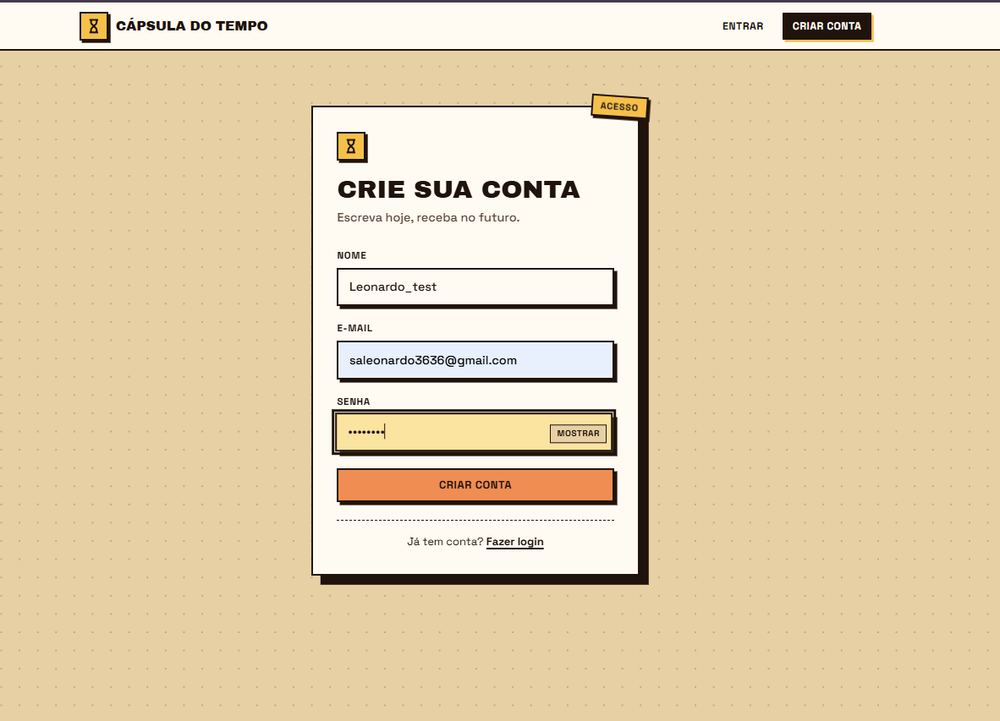
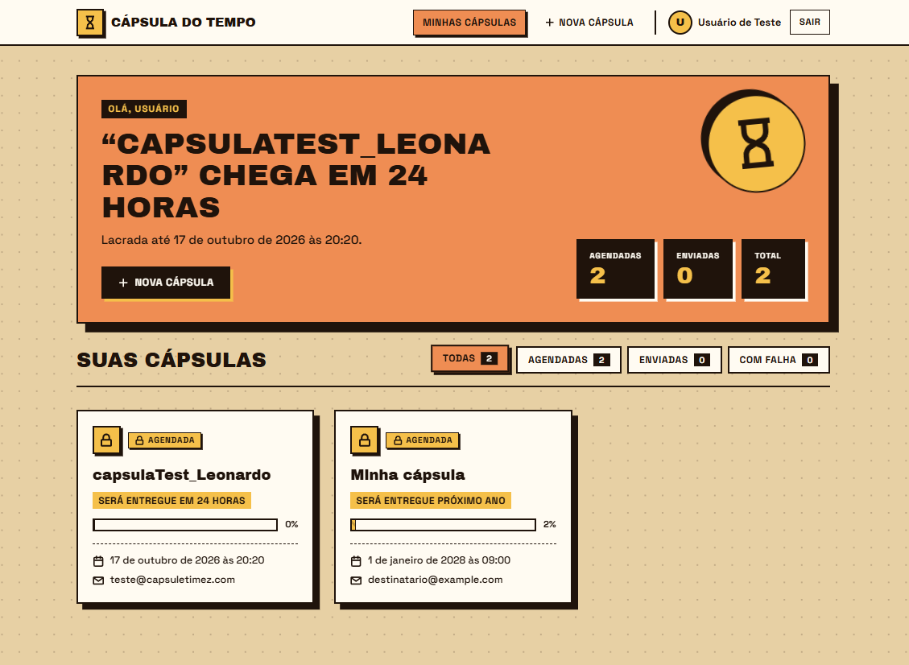
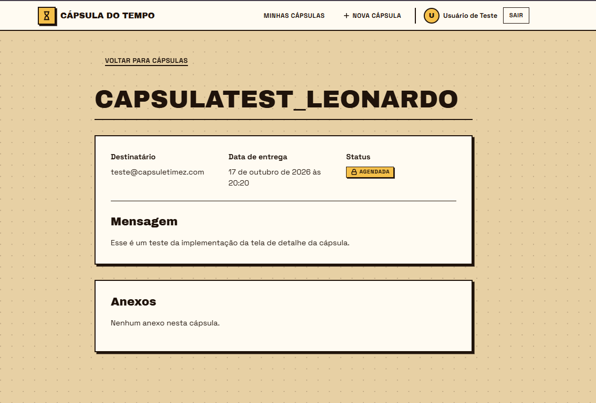

# Detalhe da cápsula na Web

A listagem permite abrir uma cápsula pelo card, inclusive usando o teclado. A rota `/capsulas/:id` exige autenticação e consulta `GET /api/capsules/{id}` com o token da sessão.

## Implementação

- Exibição de título, mensagem, destinatário, data de entrega e status.
- Listagem dos anexos com nome, tamanho e link temporário fornecido pela API.
- Mensagem explícita quando a cápsula não possui anexos.
- Estado de carregamento e opção de tentar novamente quando há falha na consulta.
- Respostas HTTP 404 exibem **Cápsula não encontrada**, tanto para IDs inexistentes quanto para cápsulas de outro usuário.
- Cancelamento da consulta ao sair do detalhe ou trocar de cápsula, evitando apresentar dados de uma consulta anterior.
- Retorno à listagem pelo botão **Voltar para cápsulas**.

A autorização por proprietário é aplicada pela API. A Web apresenta a mesma mensagem para os dois casos de 404, sem revelar dados de outro usuário.

## Validação

- `npm run build`: aprovado.
- `npm run lint`: aprovado.
- Teste manual realizado pelo responsável: abertura do detalhe com os dados da cápsula aprovada.
- Teste manual realizado pelo responsável: acesso à cápsula com outra conta aprovado, sem exibição do conteúdo.

Para reproduzir, execute a API, configure `VITE_API_URL` no `.env` do frontend e execute `npm run dev`. Faça login, crie uma cápsula e clique no card. Copie a URL, entre com outra conta e abra a mesma URL para conferir a mensagem de cápsula não encontrada.

Verificações adicionais: abrir `/capsulas/00000000-0000-4000-8000-000000000000` autenticado deve exibir a mesma mensagem; abrir uma URL de detalhe sem sessão deve redirecionar ao login. Downloads de anexos ainda precisam de validação manual com uma cápsula que contenha arquivos.

## Exemplos da execução local

### Cadastro de conta para os testes

### Listagem com cards que abrem o detalhe

### Detalhe com os dados retornados pela API

