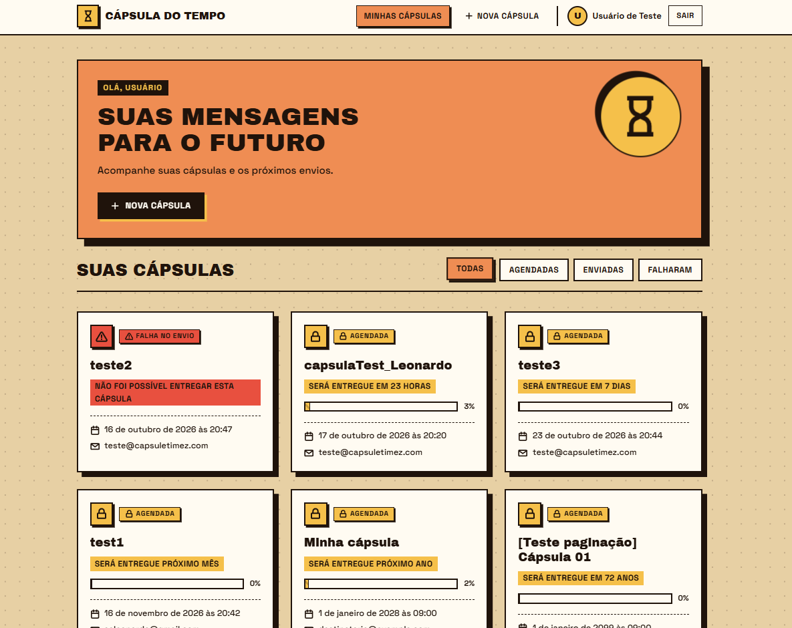
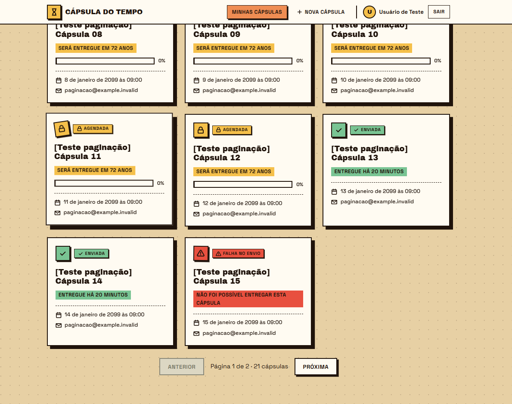
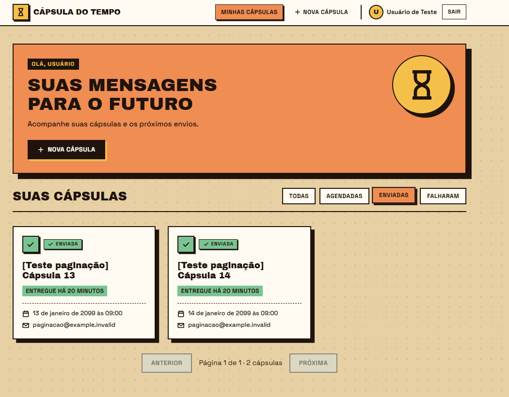
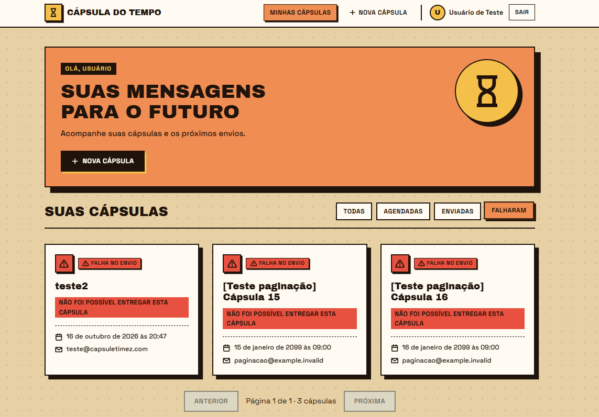

# Filtro por status e paginação da listagem

A listagem consulta a API a cada troca de status ou página, com até 20 cápsulas por página. A resposta mantém `data` e `meta`, e a navegação usa `meta.totalPages`.

## Comportamento

| Seletor | Parâmetro enviado à API |
| --- | --- |
| Todas | Sem `status` |
| Agendadas | `status=SCHEDULED` |
| Enviadas | `status=SENT` |
| Falharam | `status=FAILED` |

- Todas as consultas enviam `page` e `pageSize=20` para `GET /api/capsules`.
- Trocar o status retorna à página 1.
- Filtro e página são preservados na URL, por exemplo `/capsulas?status=SENT&page=2`, e no histórico do navegador.
- Os botões Anterior e Próxima são desabilitados nos limites da paginação.
- A lista respeita a ordenação retornada pela API.
- Estados de carregamento, erro com nova tentativa e lista vazia são tratados; os filtros continuam disponíveis.
- Consultas anteriores são canceladas ao trocar o filtro ou a página, evitando respostas fora de ordem.
- O serviço depende exclusivamente da API. O checkout usado já não tinha fallback de localStorage; esse comportamento foi mantido e coberto por teste de propagação de erros.
- As antigas contagens por status e o destaque da próxima entrega, calculados sobre toda a lista carregada, foram retirados para evitar apresentar dados parciais como totais com a paginação.

## Validação

Verificações automatizadas: `npm run build`, `npm run lint` e `npm test`.

Os três testes do serviço verificam os parâmetros de paginação, os status e o sinal de cancelamento, o retorno completo dos metadados e a propagação de falhas da API.

Teste manual confirmado pelo responsável com 21 cápsulas na mesma conta, incluindo navegação entre páginas e filtros. As capturas abaixo mostram a paginação e os resultados de Todas, Enviadas e Falharam. Parte das cápsulas com prefixo `[Teste paginação]` foi criada diretamente no banco local com status simulados; essas imagens não comprovam entrega real de e-mail. Dados de teste, credenciais e alterações do banco não fazem parte desta entrega.

Para reproduzir:

1. Execute API e frontend e entre em uma conta com mais de 20 cápsulas.
2. Em Todas, confira 20 cards na página 1 e os itens restantes na página 2.
3. Alterne os quatro filtros e confira que a consulta da API contém o status esperado.
4. Na página 2, altere o filtro e confira o retorno à página 1.
5. Recarregue a página e use voltar/avançar do navegador para conferir a preservação da seleção.

## Exemplos

### Todas

### Paginação com 21 cápsulas

### Enviadas

### Falharam

